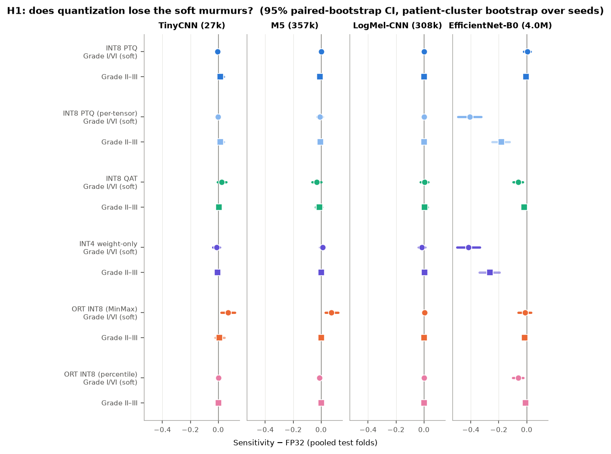
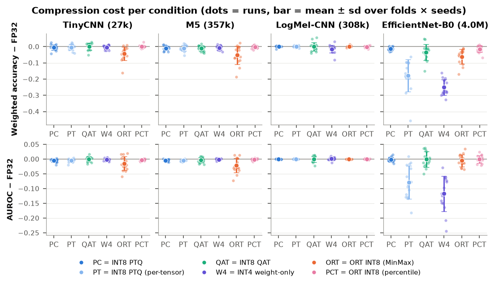

<h1 align="center">Does Quantization Forget the Quiet Murmurs?</h1>
<p align="center"><b>A Trustworthiness Audit of INT8 Heart-Sound Classifiers for Edge Screening</b></p>

<p align="center">
  
  
  
  
  
</p>

---

This repository contains the complete code, verified result tables, figures, and deployment
graphs for a **multi-axis trustworthiness audit of quantized phonocardiogram (PCG)
classifiers**. We ask not merely *whether* aggregate accuracy survives INT8 compression, but
**for whom** and **through which mechanism** it fails — on the largest public pediatric
heart-sound dataset, [CirCor DigiScope](https://physionet.org/content/circor-heart-sound/).

> 📄 **For the research paper.** The complete training code, compression sweep, trust-audit, and
> evaluation for this study are hosted here. The paper cites this repository:
>
> **https://github.com/Mustafa-bacha/pcg-quant-audit**

## Table of Contents

1. [Overview](#overview)
2. [Key Findings](#key-findings)
3. [Datasets](#datasets)
4. [Models](#models)
5. [Compression Conditions](#compression-conditions)
6. [Trust-Audit Protocol](#trust-audit-protocol)
7. [Results](#results)
8. [Mechanism: Why the Collapse Happens](#mechanism-why-the-collapse-happens)
9. [Verified-Quantization Protocol](#verified-quantization-protocol)
10. [Project Structure](#project-structure)
11. [Getting Started](#getting-started)
12. [Reproducing the Paper](#reproducing-the-paper)
13. [Figures &amp; Tables → Script Map](#figures--tables--script-map)
14. [Acknowledgements](#acknowledgements)
15. [Citation](#citation)
16. [License](#license)

## Overview

On-device murmur screening with low-cost digital stethoscopes requires quantized neural networks
to run within low-power edge envelopes. The edge heart-sound literature reports only aggregate
accuracy after INT8 conversion, leaving open whether compression silently sacrifices clinically
vulnerable patient cohorts. This study audits four architectures (27k–4.0M parameters;
raw-waveform 1D and log-mel 2D) under ten compression conditions, across murmur-grade / age /
sex / site subgroups, calibration, explanation drift, and robustness under noise and
cross-dataset shift — with patient-level 5-fold cross-validation, 3 seeds, and patient-cluster
bootstrap inference.

## Key Findings

- **Per-tensor INT8 PTQ erases soft murmurs; per-channel does not.** On EfficientNet-B0,
  per-tensor INT8 post-training quantization removes **0.407** (95% CI [0.327, 0.494], *p* < 0.001)
  of Grade-I (soft) murmur sensitivity — the cohort screening exists to catch — while per-channel
  PTQ of the *identical* checkpoints is statistically indistinguishable from FP32 (+0.003, *p* = 0.935).
- **Aggregate accuracy hides it.** The headline per-tensor weighted-accuracy drop is only −0.179;
  more than half of the clinical harm is invisible without a subgroup audit.
- **Deployment calibration silently shifts the operating point.** Default MinMax ONNX Runtime
  INT8 moves threshold behavior (M5 sensitivity 0.877→0.920, specificity 0.898→0.734) while
  threshold-free ranking barely moves (AUROC 0.942→0.928) — a bidirectional safety hazard.
- **Two zero-cost fixes remove the damage everywhere:** per-channel weight quantization +
  percentile activation calibration (and post-hoc temperature scaling for calibration), validated
  on all four architectures and both external cohorts.
- **A verified-quantization protocol** guards against a silent toolchain no-op in which a
  `torch`/`torchao` version mismatch evaluates bit-identical FP32 graphs under the guise of INT8.

## Datasets

| Dataset | Role | Size | Notes |
|---------|------|------|-------|
| **CirCor DigiScope v1.0.3** | train + internal audit | 942 patients / 3,163 recordings | patient-level 5-fold CV, stratified by murmur × campaign |
| **PhysioNet/CinC 2016** | zero-shot external | 3,240 adult recordings | multi-device; P(Present) vs. abnormal |
| **ZCHSound** | zero-shot external | 1,259 children | echo-confirmed CHD, different stethoscope, clean/noisy subsets |

Datasets are **not redistributed** here (license / size); `scripts/download_circor_s3.py` fetches
CirCor from the AWS Open Data mirror, and the external sets are obtained from their providers.

## Models

| Model | Params | Input | Role |
|-------|-------:|-------|------|
| **TinyCNN** | 27k | raw waveform | compact microcontroller-class edge model |
| **M5** | 357k | raw waveform | deep 1D CNN (Dai et al. 2017) |
| **LogMel-CNN** | 308k | log-mel | compact 2D CNN |
| **EfficientNet-B0** | 4.0M | log-mel | depthwise-separable; the quantization-fragile case |

## Compression Conditions

FP32 · dynamic INT8 · **per-channel** INT8 PTQ · **per-tensor** INT8 PTQ · INT8 QAT ·
INT4 weight-only (*simulated*) · ONNX Runtime INT8 with **MinMax / entropy / percentile**
calibration (+ symmetric-percentile) · post-hoc temperature scaling. Toolchain: `torch` +
`torchao` PT2E and ONNX Runtime QDQ (S8S8); exact per-condition settings are in the paper's
Table I and in `pcg/quant.py`.

## Trust-Audit Protocol

Every model × condition × fold × seed is scored for:

- **Discrimination** — weighted accuracy (official Challenge scorer), AUROC, sensitivity,
  specificity, FP32-vs-quantized agreement
- **Subgroups** — sensitivity by murmur grade (I vs. II–III), age, sex, auscultation site, campaign
- **Calibration** — ECE, Brier, AURC (risk–coverage), before/after temperature scaling
- **Explanations** — Integrated Gradients & occlusion drift (cosine, Spearman, top-10% overlap),
  deletion faithfulness, phase-relevance (PRR₍sys₎)
- **Shift** — additive-noise SNR sweep, campaign-stratified, two external cohorts, plus
  activation clipping / range utilization (the mechanism probe)

Inference: pooled out-of-fold patients with **patient-cluster bootstrap** (2,000 resamples).

## Results

All tables are in [`results/RESULTS.md`](results/RESULTS.md) (raw CSVs alongside), the findings
narrative in [`results/INTERIM_FINDINGS.md`](results/INTERIM_FINDINGS.md), and figures in
[`results/figures/`](results/figures/).

<p align="center">
  
  <br><em>Pooled sensitivity change vs. FP32 by murmur grade (95% patient-cluster bootstrap CIs).
  EfficientNet-B0 loses ~0.41 Grade-I sensitivity under per-tensor PTQ and simulated INT4; per-channel is lossless.</em>
</p>

<p align="center">
  
  <br><em>Weighted-accuracy and AUROC change per condition; compact models are stable, EfficientNet-B0 collapses under per-tensor INT8 and simulated INT4.</em>
</p>

## Mechanism: Why the Collapse Happens

The collapse is the known per-tensor failure of **depthwise-separable** convolutions, shown here
for the first time with its clinical, subgroup-resolved consequence on a 1D biosignal.

| Measurement | EfficientNet-B0 depthwise | Compact 1D models |
|-------------|---------------------------|-------------------|
| Channel-range ratio (max/median, post-BN-fold) | **27.3** (max 59.3) | 1.4–2.8 |
| Weight SQNR, per-tensor INT8 | **27.9 dB** | 37.9–43.8 dB |
| Weight SQNR, per-channel INT8 | 45.3 dB | — |

**Causal localization ablation:** forcing per-tensor scales in the 16 depthwise layers *alone*
reproduces the collapse (pooled Grade-I sensitivity **0.346**), while forcing them everywhere
*except* depthwise does not (0.673). Scripts and outputs: [`analysis/`](analysis/).

## Verified-Quantization Protocol

A `torch`/`torchao` mismatch can make `prepare_pt2e` insert zero observers, so `convert_pt2e`
returns the FP32 graph unchanged and every "quantized" arm silently evaluates bit-identical FP32
— internally consistent and wrong. We release a three-part defense, used for every PT2E run here:

1. **Pre-execution self-test** (`scripts/pt2e_selftest.py`) — asserts observers are inserted,
   q/dq nodes exist after conversion, and outputs differ numerically from FP32.
2. **Graph invariant assertions** inside the pipeline (`pcg/quant.py`: `_assert_prepared`, `_assert_converted`).
3. **Environment provenance stamp** written into every result file.

## Project Structure

```
pcg-quant-audit/
├── pcg/                      # Core library
│   ├── models.py            # TinyCNN, M5, LogMel-CNN, EfficientNet-B0
│   ├── quant.py             # PT2E / ORT quantization + verified-quant guards
│   ├── dataset.py           # CirCor loading, windowing, patient-level splits
│   ├── circor.py / physionet2016.py / zchsound.py   # dataset adapters
│   ├── scoring.py           # official Challenge scorer wrapper
│   ├── explain.py           # Integrated Gradients, occlusion, phase relevance
│   ├── clipping.py          # activation range / clipping probes (H2)
│   └── metrics.py / features.py / train.py / splits.py / runs.py
├── scripts/                 # Pipeline stages (p0…p5) + utilities
│   ├── p0_verify_data.py    # data + fold + scorer checks
│   ├── p1_train.py          # FP32 training
│   ├── p2_quantize.py       # compression sweep (all conditions)
│   ├── p3_audit.py          # subgroup / calibration / explanation audit
│   ├── p4_shift.py          # noise + campaign + external shift
│   ├── p4b_zchsound.py      # ZCHSound zero-shot
│   ├── p5_pooled.py         # patient-cluster bootstrap pooling
│   ├── report.py / figures.py / collect_onnx.py
│   └── pt2e_selftest.py     # verified-quantization self-test
├── analysis/                # Mechanism analyses (weight-range disparity, SQNR, ablation, operating point)
├── notebooks/               # Kaggle training/eval notebook
├── results/                 # RESULTS.md, INTERIM_FINDINGS.md, T1–T8 CSVs, figures/
├── splits/                  # patient-level fold definitions
├── third_party/             # vendored PhysioNet Challenge 2022 scorer (unmodified)
├── docs/                    # setup notes
├── requirements.txt / requirements.lock.txt
└── SYSTEM_SPEC.md
```

> Trained checkpoints, the `runs/` tree (~4 GB), ONNX graphs, and raw datasets are **not** stored
> in this repository (large binaries / dataset licenses); they are regenerated by the scripts
> below, and summary tables / figures are committed under `results/`.

## Getting Started

```bash
python -m venv .venv && source .venv/bin/activate   # Windows: .venv\Scripts\activate
pip install -r requirements.txt                      # or requirements.lock.txt for pinned versions

# 1. Fetch CirCor (AWS Open Data mirror) and verify data + folds + scorer
python scripts/download_circor_s3.py
python scripts/p0_verify_data.py

# 2. Confirm the quantization toolchain actually quantizes (guards against the silent no-op)
python scripts/pt2e_selftest.py
```

## Reproducing the Paper

```bash
python scripts/p1_train.py       --model tiny_cnn m5 logmel_cnn effnet_b0 --folds 0 1 2 3 4 --seeds 0 1 2
python scripts/p2_quantize.py    --model tiny_cnn m5 logmel_cnn effnet_b0 --folds 0 1 2 3 4 --seeds 0 1 2 --qat-epochs 5 --ort-mitigations
python scripts/p3_audit.py       --model tiny_cnn m5 logmel_cnn effnet_b0 --folds 0 1 2 3 4 --seeds 0 1 2
python scripts/p4_shift.py       --model tiny_cnn m5 logmel_cnn effnet_b0 --folds 0 1 2 3 4 --seeds 0 1 2
python scripts/p4b_zchsound.py   --model tiny_cnn m5 logmel_cnn effnet_b0 --folds 0 1 2 3 4 --seeds 0 1 2
python scripts/p5_pooled.py      --model tiny_cnn m5 logmel_cnn effnet_b0
python scripts/report.py && python scripts/figures.py && python scripts/collect_onnx.py
```

The GPU-heavy stages (p1/p2/p3/p4) also run from `notebooks/kaggle_p1_train.ipynb`.

## Figures &amp; Tables → Script Map

| Artifact | Produced by | Source table(s) |
|----------|-------------|-----------------|
| `results/figures/fig1_compression` | `scripts/figures.py` | T2 |
| `results/figures/fig2_grade` (headline) | `scripts/figures.py` | T8 (pooled subgroups) |
| `results/figures/fig3_reliability` | `scripts/figures.py` | T3 / reliability bins |
| `results/figures/fig4_explanations` | `scripts/figures.py` | T5 |
| `results/figures/fig5_shift` | `scripts/figures.py` | T6 |
| `results/figures/fig6_latency` | `scripts/figures.py` | T7b |
| `results/figures/fig7_range` | `scripts/figures.py` | T6 (clipping) |
| `results/RESULTS.md` (T1–T8) | `scripts/report.py`, `scripts/p5_pooled.py` | `runs/` |
| mechanism tables | `analysis/*.py` | checkpoints |

## Acknowledgements

Built on the [CirCor DigiScope dataset](https://physionet.org/content/circor-heart-sound/) and
the [George B. Moody PhysioNet Challenge 2022](https://physionetchallenges.org/2022/); the
official Challenge scorer is vendored unmodified under `third_party/`. Quantization uses PyTorch
`torchao` PT2E and ONNX Runtime.

## Citation

```bibtex
@misc{shah2026quietmurmurs,
  title  = {Does Quantization Forget the Quiet Murmurs? A Trustworthiness Audit of
            INT8 Heart-Sound Classifiers for Edge Screening},
  author = {Shah, Muhammad Mustafa},
  year   = {2026},
  note   = {\url{https://github.com/Mustafa-bacha/pcg-quant-audit}}
}
```

## License

Released under the [MIT License](LICENSE). The vendored PhysioNet Challenge scorer under
`third_party/` retains its original license. Datasets are governed by their respective providers'
terms.
